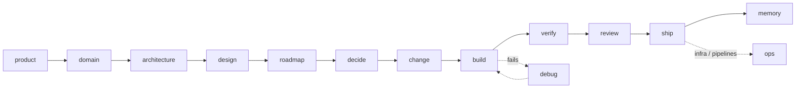

# raik-sdlc

An opinionated, agent-agnostic software delivery workflow, packaged as [Agent Skills](https://agentskills.io/).

You talk to one skill, `raik`. It reads where your project stands, picks the right step, and enforces a few gates that keep AI-assisted work honest: decisions are made by you, nothing is built without an agreed change, nothing is "done" without fresh evidence, and nothing leaves your machine without your say-so.

The workflow comes from building a real product end to end with coding agents. Every skill encodes something that was actually done and checked, not something that sounded good.

## The flow



| Skill | What it does |
|---|---|
| `raik` | Orchestrator: reads project state, routes to the right step, enforces the gates |
| `raik-decide` | Decision rounds: numbered questions with a recommendation, a "decide for me" mode, and each decision recorded where it belongs |
| `raik-change` | Specifies a change with OpenSpec: proposal, design, verifiable scenarios, tasks with evidence slots |
| `raik-verify` | Three layers of evidence: unit tests, one committed e2e per scenario, reviewed screenshots; plus regression |
| `raik-ship` | Closes tasks with evidence, archives the change and fixes links, splits commits, opens the PR, pushes only with authorization |
| `raik-init` | Bootstraps a repo: `AGENTS.md` with the `## raik` config, docs skeleton, quality gates |
| `raik-product` | Vision, users, voice, user stories with Given/When/Then |
| `raik-domain` | Glossary with code names, numbered domain rules, edge cases |
| `raik-architecture` | Every concern of a professional app, decided or marked N/A: C4, data, API, security, NFRs, operations |
| `raik-design` | Visual direction and design system |
| `raik-ui` | Builds and refines screens to the design system: required states, accessibility, responsive checks |
| `raik-roadmap` | Phases with checkpoints and an honest phase-close review |
| `raik-build` | Implementation with TDD and the stack profile |
| `raik-debug` | Hypothesis-driven debugging |
| `raik-review` | Correctness, simplification and security review of a diff |
| `raik-ops` | Terraform, CI/CD, environments, releases, monitoring |
| `raik-memory` | Session continuity and learnings |

All seventeen are in 0.1.0. Which ones have been piloted on a real project, and what comes next (an AI pack: `raik-llm`, `raik-mcp`, `raik-agents`, `raik-rag`), is in the [roadmap](docs/roadmap.md).

## Install

Any agent that supports Agent Skills (Claude Code, Codex, Cursor, Gemini CLI, OpenCode and others):

```bash
npx skills add renzoIwamoto/raik-sdlc
```

Claude Code, as a plugin:

```text
/plugin marketplace add renzoIwamoto/raik-sdlc
/plugin install raik-sdlc
```

Tools the skills call (install the ones your project uses):

```bash
npm install -g @fission-ai/openspec   # change specs (raik-change, raik-ship)
npm install -g @playwright/cli        # browser checks (raik-verify)
```

## Quick start

1. Add a `## raik` section to your project's `AGENTS.md` (see [configuration](docs/configuration.md)).
2. Ask your agent: `raik status`.
3. Then just say what you want: "add X", "what's next", "close this change".

## Docs

- [Architecture](docs/architecture.md): how the skills fit together, gates, artifacts.
- [Configuration](docs/configuration.md): the `## raik` section.
- [Standards](docs/standards.md): the base engineering standards the skills apply.
- [External skills and tools](docs/external-skills.md): what raik calls and why.
- [Roadmap](docs/roadmap.md): status of each skill and what is next.
- [Decisions](docs/adr/).

## Credits

Ideas borrowed, not code: hypothesis-driven debugging and verification before completion from [obra/superpowers](https://github.com/obra/superpowers); excuse-and-rebuttal tables and review personas from [addyosmani/agent-skills](https://addyosmani.com/blog/agent-skills/).

## License

[MIT](LICENSE) © Renzo Iwamoto
