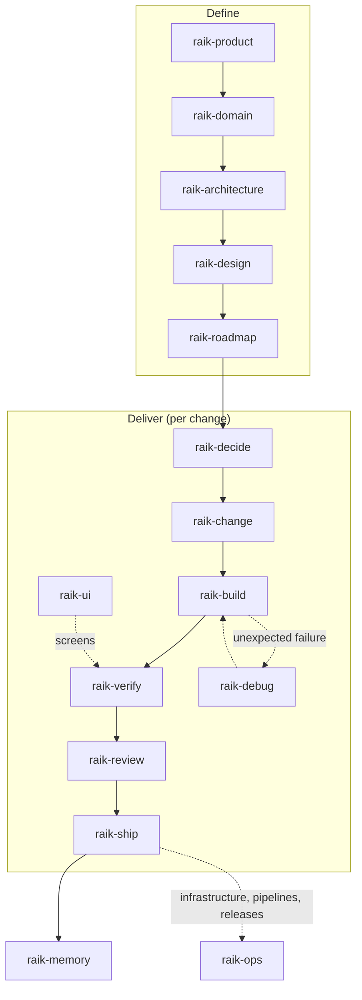

# Architecture

How raik-sdlc is put together. For the configuration a project provides, see [configuration](configuration.md).

## Pieces

| Piece | What it is | Where |
|---|---|---|
| Orchestrator | The `raik` skill. Reads project state, classifies the request into a stage, runs that stage's skill and enforces the gates | `skills/raik/` |
| Stage skills | One skill per step of the workflow (`raik-decide`, `raik-change`...). Each can also be called directly | `skills/raik-*/` |
| References | Standards and guides a skill loads only when a step needs them, so the agent's context stays small | `skills/*/references/` |
| Assets and scripts | Templates the skills fill in and checks they run (Python stdlib, no installs) | `skills/*/assets/`, `skills/*/scripts/` |
| Project config | A `## raik` section in the project's `AGENTS.md`: languages, stack, commands, policies | the project |
| Tools | Programs the skills call: OpenSpec, Playwright CLI, test runners, linters, Terraform | installed per project |

Only `skills/` reaches a project when installed. These docs are for people; anything a skill needs at runtime lives in its own folder.

## The flow

Define runs once per product and again when something fundamental changes. Deliver runs once per change; most days are spent there.

## Gates

The orchestrator stops the flow when a gate is not met and says which one.

| Gate | Rule | Why |
|---|---|---|
| G1 Decisions | Product and architecture choices are the user's. The agent recommends; the user answers or says "decide for me", and the agent lists what it chose | The user owns the product; the agent owns the legwork |
| G2 Change first | No build without an agreed change. Trivial edits (typos, versions, styling) are exempt | Scope stays visible and reviewable |
| G3 Evidence | Nothing is "done" without evidence from commands run after the last code change, in this session | Agents report success that never happened |
| G4 Authorization | No commit, push, PR, deploy or publish without the user's go-ahead for that batch | These leave the machine or are hard to undo |
| G5 Docs travel with code | Docs, specs and roadmap are updated in the same change as the behavior they describe | Docs that lag become lies |

## Artifacts in a project

| Artifact | Path (default) | Written by |
|---|---|---|
| Agent instructions and raik config | `AGENTS.md` | `raik-init` |
| Vision, users, stories | `docs/vision.md`, `PRODUCT.md`, `docs/product/user-stories.md` | `raik-product` |
| Glossary and domain rules | `docs/domain.md`, `CONTEXT.md` | `raik-domain` |
| Architecture, NFRs, security, ADRs | `docs/architecture.md`, `docs/nfr.md`, `docs/security.md`, `docs/adr/` | `raik-architecture` |
| Design system | `DESIGN.md` | `raik-design` |
| Roadmap and phase reviews | `docs/roadmap.md` | `raik-roadmap` |
| Changes and specs | `openspec/changes/`, `openspec/specs/` | `raik-change`, `raik-ship` |
| Tests | per stack; e2e in `e2e/` or the web app's `e2e/` | `raik-build`, `raik-verify` |
| Evidence | the change's `tasks.md` (Evidence lines) and screenshots | `raik-verify` |
| Infrastructure | `infra/` | `raik-ops` |

Paths are defaults; a project can override them in its config.

## External skills and tools

raik calls the best existing tool for a job instead of rewriting it (OpenSpec for specs, Playwright CLI for browsers, Impeccable for visual design). It does not install other workflow collections: two skills that both claim "how to plan" or "how to do TDD" leave the agent guessing. See [external skills](external-skills.md).

## Distribution and versions

- Format: the [Agent Skills](https://agentskills.io/) standard, so one source works in any compatible agent.
- Install: `npx skills add renzoIwamoto/raik-sdlc`, or the Claude Code plugin in `.claude-plugin/`.
- Versions: semantic, tagged, with `CHANGELOG.md`. A project records the version it uses in its config.
